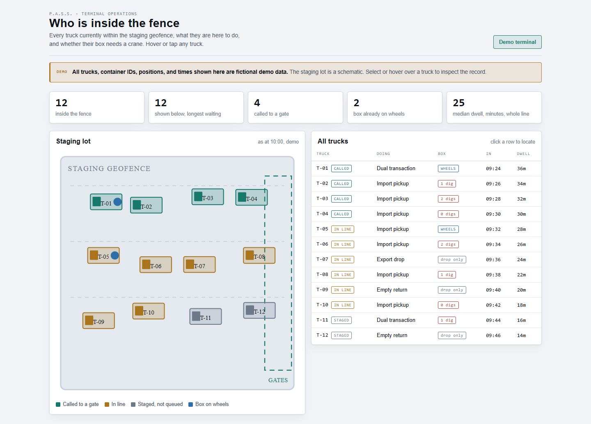
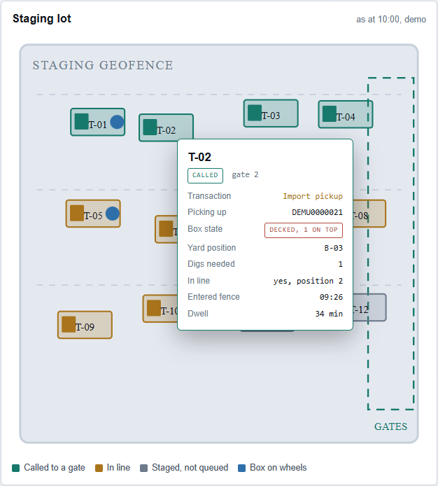

# P.A.S.S. (Pier Access Sequence System)

An early-stage logistics prototype that explores how to reduce the time drayage drivers spend picking up containers at marine terminals in Los Angeles and Long Beach.

> This is a showcase repo. A walkthrough is available on request. Source code, detailed simulation results, and the full demo are private.

**Contact:** jahan.atkins815@gmail.com | [linkedin.com/in/jahan-atkins-39002b419](https://linkedin.com/in/jahan-atkins-39002b419)

## The problem

Long waits cut into the number of trips a drayage driver can make. Truck arrivals can bunch up at the gate, and inefficient pickup sequences can add crane work inside the terminal.

## The approach

P.A.S.S. started with sequencing trucks to reduce crane work. The prototype also explores how the timing of truck arrivals affects the gate queue. The simulator tracks time waiting to enter, time inside the terminal, and total time separately. The work is at the simulation and prototype stage.

## What's built so far

- **Core engine:** a framework-free Python model of terminal operations plus a set of sequencing strategies, from a first-come-first-served baseline up to more advanced approaches
- **Simulator and benchmark harness:** a discrete-event simulator that tests each strategy across many randomized runs, including control scenarios where a real improvement should not appear
- **Backend:** a FastAPI scaffold and adapters for external data sources
- **Mobile prototype:** an Expo (React Native) driver demo

## Prototype screenshots

The terminal operations board uses fictional demo data and a schematic staging lot.

**Terminal overview**

**Truck detail**

## Tech stack

| Layer | Tools |
|---|---|
| Core logic | Python, NumPy, SimPy |
| Backend | FastAPI |
| Mobile | Expo (React Native), TypeScript |
| Database | Postgres with PostGIS (planned) |
| Testing | pytest, Hypothesis (property-based testing), ruff, mypy |
| Infrastructure | Docker, CI |

## Engineering approach

- **Benchmark against controls.** The simulator compares strategies with a first-come, first-served baseline and includes scenarios where a benefit should be small. It tracks both wait times and how those waits are distributed across drivers.
- **Honest milestones.** The project is planned in milestones with written acceptance criteria, and design decisions are recorded as architecture decision records (ADRs).
- **Clean separation.** The core engine has no web framework or database code, so it can be tested on its own and reused anywhere.

## My role

I co-founded P.A.S.S. with Lamour Atkins and built the core engine, simulator, and backend prototype.

## What I learned

- Turning a real logistics problem into a measurable software design
- Using simulation and controls to tell a real improvement from noise
- Property-based testing for code where correctness really matters
- Recording decisions so a small team stays aligned
